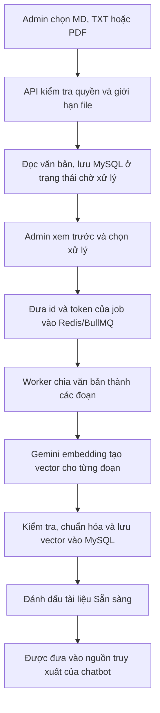
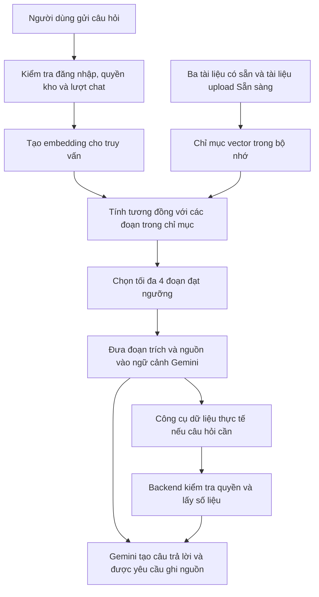

# Giải thích RAG trong dự án kho lạnh — tài liệu chuẩn bị bảo vệ

Đối chiếu mã nguồn ngày 02/11/2026, nhánh `feat/chatbot-rag`.

## 1. Cách giới thiệu trong khoảng một phút

> Trong dự án, em bổ sung RAG cho chatbot để trả lời dựa trên tài liệu nghiệp vụ của hệ thống. RAG là kết hợp truy xuất thông tin với sinh câu trả lời.
>
> Hệ thống có hai luồng. Luồng chuẩn bị tài liệu cho Admin tải file lên, xem trước văn bản rồi yêu cầu xử lý. Backend chia nội dung thành các đoạn, gọi mô hình embedding để biến từng đoạn thành vector và lưu lại.
>
> Khi người dùng hỏi, hệ thống cũng tạo vector cho câu hỏi, so sánh với các vector tài liệu để lấy những đoạn liên quan nhất. Câu hỏi và các đoạn trích được đưa vào mô hình Gemini để viết câu trả lời, kèm yêu cầu ghi nguồn.
>
> Riêng câu hỏi về nhiệt độ hiện tại hoặc cảnh báo đang mở, chatbot gọi các công cụ lấy dữ liệu thực tế có kiểm tra quyền theo kho. RAG tài liệu phụ trách kiến thức hướng dẫn dùng chung.

Mô tả trên là luồng đã triển khai trong code. Tình trạng kiểm chứng hiện tại nằm ở mục 11; khi trình bày cần phân biệt triển khai phần mềm với kết quả đánh giá mô hình bằng API thật.

## 2. RAG là gì và giải quyết vấn đề nào?

RAG viết tắt của **Retrieval-Augmented Generation**: sinh câu trả lời có bổ sung thông tin truy xuất được. Mô hình sinh nhận thêm bằng chứng từ nguồn kiến thức bên ngoài để sử dụng trong ngữ cảnh trả lời. Tài liệu tham khảo nền tảng: [Lewis và cộng sự, Retrieval-Augmented Generation for Knowledge-Intensive NLP Tasks](https://arxiv.org/abs/2005.11401).

Trong dự án, các quy tắc như ai được gửi lệnh quạt, ca trực phải được duyệt ra sao hoặc khi nào cảnh báo tự đóng là thông tin riêng của phần mềm. Mô hình ngôn ngữ không tự biết chính xác phiên bản đang chạy. RAG cung cấp những nội dung đã được rà soát để mô hình có căn cứ khi trả lời.

Ba công việc cốt lõi:

| Công việc | Ý nghĩa trong dự án |
| --- | --- |
| Retrieval — truy xuất | Tìm các đoạn tài liệu liên quan đến câu hỏi |
| Augmentation — bổ sung ngữ cảnh | Đưa câu hỏi, đoạn trích và thông tin nguồn vào yêu cầu gửi mô hình |
| Generation — sinh câu trả lời | Gemini diễn giải thông tin thành câu trả lời cho người dùng |

RAG giúp cung cấp căn cứ và cập nhật kiến thức qua tài liệu. Hiệu quả vẫn phụ thuộc tài liệu đúng, tìm đúng đoạn và mô hình diễn giải đúng; cần đo thực nghiệm trước khi kết luận chất lượng được cải thiện bao nhiêu.

## 3. Các thành phần cụ thể đã chọn

| Thành phần | Triển khai hiện tại |
| --- | --- |
| Giao diện | React; trang Admin **Quản trị → Tài liệu chatbot** |
| API | NestJS; kiểm tra JWT và vai trò Admin cho quản lý tài liệu |
| Đọc file | MD/TXT UTF-8; PDF có văn bản bằng `pdf-parse` |
| Hàng đợi | BullMQ, hàng đợi `chatbot-documents` trong Redis |
| Xử lý nền | Worker riêng; một job tài liệu tại một thời điểm |
| Mô hình embedding | `gemini-embedding-001` qua Gemini API |
| Biểu diễn mỗi đoạn | Vector 768 chiều, được chuẩn hóa |
| Lưu tài liệu tải lên | MySQL: metadata, văn bản trích xuất, trạng thái, vector và mã đoạn |
| Chỉ mục dùng khi tìm kiếm | File JSON và bộ nhớ backend; kết hợp nguồn đi kèm với tài liệu đã xử lý |
| Xếp hạng | Tính cosine similarity trực tiếp trên các vector |
| Chọn kết quả | Mặc định tối đa 4 đoạn có điểm từ 0,45 trở lên |
| Sinh câu trả lời | Mô hình Gemini cấu hình qua `LLM_MODEL`, riêng với model embedding |

Các thông số trên được đọc từ mã nguồn và cấu hình mẫu. Chúng là lựa chọn triển khai ban đầu, chưa phải thông số tối ưu đã được benchmark trên API thật.

## 4. Luồng A: đưa tài liệu vào kho kiến thức



### Bước 1: tải lên và kiểm tra file

Admin nhập tên và chọn file. Backend kiểm tra vai trò, phần mở rộng, kích thước và nội dung thực tế. Giới hạn hiện tại là 5 MB/file, 40 trang/PDF và 60.000 ký tự văn bản/file. PDF scan chưa có OCR; file không có văn bản đọc được sẽ bị từ chối.

Backend lưu bản văn bản đã trích xuất vào bảng `chatbot_documents`, cùng tên, thông tin file và trạng thái **pending — Chờ xử lý**. Bản này không lưu lại PDF gốc để tải xuống. Nội dung được băm SHA-256 để ngăn tải trùng cùng văn bản đã chuẩn hóa. SHA-256 là phép băm để nhận diện nội dung, khác với embedding dùng cho tìm kiếm ý nghĩa.

Ở bước tải lên, backend có thể chia thử để tính số đoạn và kiểm tra giới hạn kho tài liệu. **Chưa có lệnh gọi API embedding ở bước này.**

### Bước 2: xem trước rồi yêu cầu xử lý

Admin kiểm tra chữ và cách ngắt dòng, sau đó bấm **Xử lý để chatbot sử dụng** và xác nhận. Hệ thống chuyển trạng thái **queued — Đang xếp hàng** và thêm job vào BullMQ.

Job chỉ chứa id tài liệu và token nhận diện lần xử lý. Văn bản được lưu ở MySQL. Cách này giúp request HTTP kết thúc sớm và để worker thực hiện công việc gọi API có thể mất thời gian.

### Bước 3: chia đoạn — chunking

Worker đọc lại văn bản và chia theo đề mục Markdown. Mỗi đoạn dài tối đa khoảng **1.200 ký tự**; nếu một mục dài cần nhiều đoạn thì các đoạn liên tiếp chồng nhau **180 ký tự**. Bộ chia cố gắng cắt ở chỗ xuống dòng. Với PDF/TXT không có đề mục Markdown, nội dung được chia theo độ dài dưới tên tài liệu.

Ví dụ một quy trình có điều kiện ở cuối đoạn đầu và hành động ở đầu đoạn sau: phần chồng giúp hai đoạn giữ được một phần ngữ cảnh chung khi được truy xuất riêng. Đổi lại, overlap tăng số ký tự phải embedding và có thể tạo các đoạn truy xuất lặp nội dung.

Mỗi đoạn có mã riêng, tên nguồn, tên tài liệu, đề mục và nội dung. Đây là thuật toán chia đoạn của backend; chưa sử dụng một mô hình AI để xác định ranh giới ngữ nghĩa.

### Bước 4: tạo embedding

Embedding là một mô hình AI đã được huấn luyện sẵn để biến văn bản thành biểu diễn số. Trong code này, backend gọi Gemini API với `taskType: RETRIEVAL_DOCUMENT` và yêu cầu 768 chiều. Đầu vào gồm tên tài liệu, đề mục và đoạn văn. Cách gọi API và các task type được Google mô tả trong [tài liệu embeddings](https://ai.google.dev/gemini-api/docs/embeddings).

Ví dụ **chỉ để minh họa**, rút gọn còn ba chiều:

```text
"Tắt quạt làm lạnh"     → [0.80, 0.20, 0.50]
"Ngừng bộ làm mát"      → [0.78, 0.23, 0.49]
"Nhập một lô hàng mới"  → [0.10, 0.90, 0.15]
```

Các số này không phải kết quả Gemini thật. Chúng minh họa ý tưởng rằng nội dung gần nghĩa có thể có vector gần nhau. Mỗi chiều là một đặc trưng mô hình học được; không gán thủ công chiều thứ nhất là quạt, chiều thứ hai là nhiệt độ. Ý nghĩa được biểu diễn qua cả vector.

### Bước 5: kiểm tra, chuẩn hóa và lưu

Worker kiểm tra số lượng vector khớp số đoạn, mỗi vector đủ 768 phần tử, mọi phần tử là số hữu hạn và vector không bằng không. Sau đó chuẩn hóa theo độ dài:

```text
v_chuẩn_hóa = v / sqrt(v1² + v2² + ... + v768²)
```

Kết quả được lưu trong trường JSON `embedding_data`, kèm tên model, số chiều và danh sách mã đoạn. Chỉ khi lưu thành công tài liệu mới chuyển sang **ready — Sẵn sàng**. Nếu có lỗi, trạng thái là **failed — Xử lý thất bại**, để Admin có thể thử lại.

Có giới hạn thời gian xử lý. Khi tài liệu đã xóa hoặc token của job không còn phù hợp, kết quả job không được đưa lại vào tài liệu. Hàng đợi được lưu ở Redis, nên công việc chờ không phụ thuộc vào việc trình duyệt Admin vẫn đang mở.

## 5. Luồng B: xử lý câu hỏi của người dùng



### Bước 1: chuẩn bị truy vấn và nguồn kiến thức

Backend lấy tối đa hai tin nhắn người dùng gần nhất để hỗ trợ câu hỏi tiếp nối, giới hạn chuỗi truy vấn 2.000 ký tự. Nguồn gồm:

- Ba file đi kèm: `BUSINESS_RULES.md`, `SYSTEM_OPERATIONS_GUIDE.md`, `TROUBLESHOOTING.md`.
- Tài liệu Admin tải lên có trạng thái ready và dữ liệu vector hợp lệ.

Những tài liệu đang chờ, đang xử lý hoặc đã xóa không được đưa vào nguồn truy xuất mới. Ba file có sẵn được tạo vector khi cần nếu cache chưa có; tài liệu upload dùng lại vector worker đã tạo.

### Bước 2: embedding câu hỏi

Backend gọi cùng model embedding, dùng nhiệm vụ **RETRIEVAL_QUERY**, nhận một vector cũng có 768 chiều rồi chuẩn hóa. Vector câu hỏi lặp lại được cache tối đa năm phút; cache có giới hạn 100 mục.

Vector câu hỏi và vector đoạn tài liệu có thể so sánh được vì dùng cùng model và cấu hình chiều tương thích. Cần giữ các thông tin model, số chiều và mã đoạn khi lưu để tránh ghép nhầm dữ liệu cũ với văn bản mới.

### Bước 3: tính cosine similarity và chọn top-k

Công thức:

```text
cosine(q, d) = (q · d) / (||q|| × ||d||)
```

Trong đó `q` là vector truy vấn, `d` là vector một đoạn tài liệu. Do đã chuẩn hóa độ dài, backend tính bằng tích vô hướng:

```text
score = q1*d1 + q2*d2 + ... + q768*d768
```

Backend tính điểm cho các đoạn, giữ đoạn đạt ngưỡng, sắp xếp giảm dần rồi lấy tối đa bốn đoạn. Cấu hình mặc định là **top-k = 4**, **minScore = 0,45**. Nếu chỉ có hai đoạn đạt ngưỡng thì chỉ lấy hai đoạn; nếu không có thì kết quả rỗng.

**Điểm 0,8 không có nghĩa câu trả lời đúng 80%.** Đây là điểm tương đồng phục vụ xếp hạng, chưa được hiệu chỉnh thành xác suất đúng. Ngưỡng 0,45 là lựa chọn cấu hình ban đầu, cần đánh giá và điều chỉnh bằng câu hỏi có nhãn.

### Bước 4: bổ sung ngữ cảnh — augmentation

Backend đưa vào system instruction một cấu trúc chứa phương thức truy xuất, nội dung đoạn trích và thông tin nguồn. Bên cạnh đó vẫn có hướng dẫn về phạm vi hỗ trợ, thời điểm hiện tại và kho đang chọn. Lịch sử hội thoại và các công cụ được cung cấp theo luồng chatbot hiện có.

Nội dung tài liệu được xem là bằng chứng để tham khảo. Prompt yêu cầu không làm theo các chỉ thị trong tài liệu nhằm đổi vai trò, bỏ quy tắc hoặc tiết lộ bí mật. Đây là hướng dẫn cho mô hình; việc bảo vệ quyền đọc dữ liệu vẫn được thực thi bằng code ở backend.

### Bước 5: sinh câu trả lời — generation

Gemini nhận câu hỏi cùng ngữ cảnh liên quan để viết câu trả lời. Prompt yêu cầu ghi nguồn bằng tên tài liệu và đề mục, không tự bịa nguồn hoặc quy tắc chưa có căn cứ. Nếu cần tra thêm, mô hình có thể gọi `search_docs`, dùng cùng bộ tìm kiếm.

Phần yêu cầu trích nguồn hiện được thực hiện bằng prompt; chưa có bộ kiểm chứng tự động mọi phát biểu và trích dẫn trong câu trả lời cuối cùng. Vì vậy vẫn phải kiểm tra độ đúng và độ bám nguồn bằng thực nghiệm.

## 6. Ví dụ dùng khi trình bày

Đây là **kịch bản mong muốn để giải thích cơ chế**, chưa phải kết quả benchmark API thật.

Tài liệu chứa quy tắc: **Quản lý chỉ xem lịch sử lệnh, không gửi lệnh.**

Người dùng hỏi: **“Tài khoản manager có tắt bộ làm mát được không?”**

Hệ thống cần tìm được mục **Ai được gửi lệnh điều khiển** dù câu hỏi diễn đạt khác câu trong tài liệu. Sau khi tìm được đoạn đó, Gemini có căn cứ trả lời rằng Quản lý không có quyền gửi lệnh bật/tắt quạt và ghi nguồn là Quy tắc nghiệp vụ — Ai được gửi lệnh điều khiển.

Có thể hỏi tiếp: **“Phòng A hiện tại bao nhiêu độ?”** Với câu này, văn bản hướng dẫn không chứng minh nhiệt độ hiện tại. Chatbot phải gọi công cụ lấy dữ liệu phòng có kiểm tra quyền. Một câu hỏi như “Phòng A đang vượt ngưỡng thì nên kiểm tra gì?” có thể cần cả dữ liệu thực tế và hướng dẫn từ tài liệu.

## 7. Những điểm dễ bị nhầm khi thầy hỏi

### RAG có phải huấn luyện lại Gemini không?

Trong triển khai này, không cập nhật trọng số của model embedding hoặc model sinh. Hệ thống tạo chỉ mục tài liệu và cung cấp các đoạn liên quan ở thời điểm hỏi. Thêm tài liệu làm thay đổi nguồn truy xuất. Fine-tuning là một hướng cập nhật tham số mô hình; có thể kết hợp với RAG trong một hệ thống khác, nhưng dự án hiện chưa làm phần đó.

### Dự án có hai loại mô hình AI nào liên quan?

Chatbot dùng model embedding để tìm tài liệu và model sinh Gemini để viết câu trả lời. Ngoài ra, dịch vụ dự báo nhiệt độ HGB 5–10 phút là một chức năng riêng của hệ thống IoT. Tải tài liệu vào RAG không huấn luyện lại mô hình dự báo nhiệt độ.

### Vì sao chia đoạn, không đưa toàn bộ tài liệu vào mỗi câu hỏi?

Chia đoạn giúp lấy phần liên quan để gửi vào mô hình, kiểm soát độ dài ngữ cảnh và giữ thông tin nguồn. Đổi lại, chia quá ngắn có thể mất ngữ cảnh, chia quá dài có thể làm loãng nội dung cần tìm. RAG có thêm chi phí embedding và có thể tìm sai đoạn; cần so sánh với cách đưa toàn bộ tài liệu khi đánh giá.

### Có bắt buộc dùng vector database không?

Không bắt buộc. Bản hiện tại lưu vector tài liệu upload trong MySQL và tạo chỉ mục JSON/bộ nhớ ở backend. Backend tự tính điểm trên từng vector; MySQL đang làm nhiệm vụ lưu trữ, không chạy phép tìm kiếm vector ở tầng SQL.

Đây là tìm kiếm chính xác bằng cách xét các đoạn trong chỉ mục, chưa có ANN hay một hệ vector database riêng. Phần tính điểm có chi phí xấp xỉ O(N × d), với N là số đoạn và d = 768. Với giới hạn hiện tại khoảng 300 đoạn, cách này phù hợp để triển khai và giải thích trong bài tập lớn. Khi quy mô tăng cần đo lại độ trễ và lựa chọn cấu trúc tìm kiếm phù hợp.

### “Index” là gì? Lưu vector rồi sao còn có index?

Ở đây, index là cấu trúc ghép mã đoạn với vector theo thứ tự, có model, số chiều, phiên bản chia đoạn và fingerprint của corpus. Nó giúp backend biết vector nào ứng với văn bản nào và tái sử dụng các kết quả đã có. Từ “index” trong bản này không hàm ý đã dùng một cây tìm kiếm hay thuật toán ANN chuyên dụng.

### Dữ liệu nằm ở đâu?

| Dữ liệu | Nơi lưu hoặc xử lý |
| --- | --- |
| Ba tài liệu đi kèm | Thư mục `docs/`, được đóng gói vào image |
| Văn bản và metadata upload | MySQL, bảng `chatbot_documents` |
| Vector upload đã xử lý | Trường JSON `embedding_data` của bảng trên |
| Job chờ xử lý | Redis/BullMQ; job chứa id và token |
| Chỉ mục tổng hợp | File JSON và bộ nhớ backend |
| Vector truy vấn lặp lại | Cache trong bộ nhớ, tối đa năm phút |
| Suy luận embedding và sinh câu trả lời | Dịch vụ Gemini API |

### Tài liệu thay đổi hoặc bị xóa thì xử lý thế nào?

Hệ thống băm nguồn và cấu hình để nhận ra corpus thay đổi. Các vector của đoạn không đổi được dùng lại. Văn bản chỉ được ghép với vector có mã đoạn và cấu hình phù hợp. Tài liệu xóa bị loại khỏi lần lấy nguồn mới; job cũ không được tạo lại bản ghi đã xóa. Tin nhắn lịch sử đã trả lời không bị xóa theo tài liệu.

Giao diện hiện có tải lên, xem trước, xử lý lại và xóa; chưa có chỉnh sửa nội dung trực tiếp hoặc quản lý phiên bản tài liệu đầy đủ. Thay nội dung có thể thực hiện bằng việc xóa bản cũ rồi tải bản mới.

### Nếu embedding gặp lỗi thì sao?

Khâu truy xuất có thể chuyển sang tìm từ khóa, trả rõ `method: keyword_fallback`. Khi không có tài liệu có thể dùng hoặc lỗi đọc nguồn, có thể trả `unavailable`. Cơ chế có timeout và khoảng chờ trước khi thử lại để tránh gọi API dồn.

Fallback từ khóa thay thế khâu tìm tài liệu. **Để Gemini sinh câu trả lời vẫn cần dịch vụ model sinh hoạt động.** Không có khóa hoặc mất kết nối với cả dịch vụ Gemini thì không thể coi toàn bộ chatbot vẫn hoạt động như bình thường.

Ready chỉ xác nhận tài liệu đã có dữ liệu tìm kiếm hợp lệ. Một lượt hỏi sau đó vẫn có thể gặp lỗi API tạo embedding truy vấn hoặc lỗi model sinh.

### Đây có phải hybrid search không?

Bản hiện tại dùng vector làm cách tìm kiếm chính và dùng từ khóa khi vector search không khả dụng. Chưa phối hợp đồng thời hai bộ xếp hạng theo một thuật toán hybrid, chưa có model reranker riêng.

### Vì sao chỉ Admin được quản lý tài liệu?

Tài liệu này là kiến thức dùng chung cho người dùng chatbot. Thay đổi tài liệu ảnh hưởng nội dung hệ thống có thể trả lời, nên quyền upload, xem quản trị, xử lý và xóa được kiểm tra cả ở frontend lẫn API.

Hiện chưa có kho tài liệu riêng theo từng warehouse. Quyền truy cập số liệu vận hành được kiểm tra độc lập qua các công cụ backend. Chatbot chỉ có công cụ đọc, không có công cụ tự gửi lệnh quạt/còi hoặc sửa lô hàng.

### Tốn phí ở bước nào?

Tải lên và đọc file không gọi API embedding. Sau xác nhận xử lý mới gọi embedding tài liệu. Lượt hỏi có thể gọi embedding truy vấn và model sinh; đoạn tài liệu được thêm vào prompt cũng là đầu vào của model sinh. Cache và dùng lại vector giúp giảm số lần gọi. Có phát sinh tiền hay không phụ thuộc gói và hạn mức của project Gemini; không thể suy ra chỉ từ số file.

## 8. Cách đánh giá để nói có cơ sở

Tách ba nhóm đánh giá:

1. **Chức năng phần mềm:** upload, đọc file, trạng thái, queue, xóa, validation, quyền truy cập, dữ liệu trả về.
2. **Chất lượng truy xuất:** câu hỏi có nhãn file/đề mục đúng; kiểm tra mục đó có xuất hiện trong top-k và đứng ở vị trí nào.
3. **Chất lượng câu trả lời:** đúng nghiệp vụ, đầy đủ, bám nội dung nguồn, trích nguồn đúng, biết báo thiếu thông tin và tuân thủ quyền dữ liệu.

Chỉ số truy xuất có thể dùng:

- **Recall@k:** mức tìm được tài liệu/mục liên quan trong k kết quả. Với suite hiện tại mỗi câu gán một mục đúng, chỉ số là tỷ lệ câu tìm được mục đích trong top-k.
- **MRR:** trung bình nghịch đảo thứ hạng của kết quả đúng đầu tiên; kết quả đúng xuất hiện càng sớm thì điểm càng cao.
- **Độ trễ:** thời gian từ lúc bắt đầu truy xuất đến khi có kết quả; nên phân biệt lần tạo index đầu tiên với lần đã có cache.

Không đồng nhất Recall@k với độ chính xác câu trả lời. Truy xuất đúng vẫn có thể bị model diễn giải sai; test phần mềm đạt cũng không chứng minh model trả lời đúng mọi câu.

Code có ba chế độ để so sánh: `none` không bổ sung tài liệu, `prompt` đưa toàn bộ cùng nguồn tài liệu trong giới hạn cấu hình, `rag` lấy các đoạn liên quan. Khi so sánh cần cùng bộ câu hỏi, tài khoản, model sinh và hội thoại mới; chế độ none vẫn có kiến thức sẵn của Gemini và các công cụ dữ liệu.

CLI có bộ 16 câu hỏi phát triển cho ba tài liệu đi kèm. Nó chưa đánh giá tài liệu upload từ database. Cần bổ sung một tập câu hỏi độc lập để đánh giá có ý nghĩa rộng hơn.

## 9. Những file nên mở nếu thầy muốn xem code

| Muốn chứng minh phần nào | File |
| --- | --- |
| Giao diện upload và trạng thái | [ChatbotDocumentsPage.tsx](../frontend/src/pages/ChatbotDocumentsPage.tsx) |
| Quyền Admin và các API | [chatbot-documents.controller.ts](../server/src/modules/chatbot/documents/chatbot-documents.controller.ts) |
| Đọc MD/TXT/PDF | [chatbot-document-reader.ts](../server/src/modules/chatbot/documents/chatbot-document-reader.ts) |
| Đưa vào queue, tạo vector và lọc nguồn ready | [chatbot-documents.service.ts](../server/src/modules/chatbot/documents/chatbot-documents.service.ts) |
| Worker nhận job | [chatbot-document.processor.ts](../server/src/workers/processors/chatbot-document.processor.ts) |
| Gọi API embedding | [chatbot-embedding.service.ts](../server/src/modules/chatbot/documents/chatbot-embedding.service.ts) |
| Chia đoạn, chuẩn hóa, cosine, top-k và cache | [chatbot-rag.ts](../server/src/modules/chatbot/tools/chatbot-rag.ts) |
| Kết hợp nguồn và chọn chế độ kiến thức | [chatbot-knowledge.service.ts](../server/src/modules/chatbot/tools/chatbot-knowledge.service.ts) |
| Đưa kết quả truy xuất vào yêu cầu Gemini | [chatbot-orchestrator.service.ts](../server/src/modules/chatbot/chatbot-orchestrator.service.ts) |
| Hướng dẫn bám nguồn trong prompt | [chatbot-system-prompt.constant.ts](../server/src/modules/chatbot/chatbot-system-prompt.constant.ts) |
| Kiểm tra quyền khi gọi công cụ dữ liệu | [chatbot-tool-executor.service.ts](../server/src/modules/chatbot/tools/chatbot-tool-executor.service.ts) |

## 10. Chuẩn bị demo

1. Cài dependency, chạy migration và dùng backend/worker cùng phiên bản theo [hướng dẫn tài liệu chatbot](CHATBOT_DOCUMENTS.md).
2. Cấu hình khóa Gemini, model sinh hợp lệ và bật chế độ rag; kiểm tra quota và mạng Internet cho cả hai loại lệnh gọi model.
3. Chuẩn bị một file nhỏ có nội dung nghiệp vụ đúng, dễ kiểm chứng, tránh thử lần đầu bằng PDF dài hoặc scan.
4. Đăng nhập Admin, tải lên, xem trước, chọn xử lý và chờ Sẵn sàng. Sau đó mở hội thoại mới.
5. Hỏi bằng một cách diễn đạt khác câu trong tài liệu, kiểm tra câu trả lời và nguồn. Hỏi thêm một câu thiếu thông tin để quan sát cách phản hồi.
6. Phân biệt kiểm tra GUI với đo truy xuất. Hàm tìm kiếm có trường `method`; CLI có thể xác nhận semantic cho ba file đi kèm. Frontend hiện chưa có màn hình debug đầy đủ cho ngữ cảnh RAG tự động của từng lượt.
7. Nếu dịch vụ lỗi, trình bày đúng trạng thái và phạm vi fallback. Không dùng kết quả giả lập làm số liệu benchmark Gemini thật.

## 11. Tình trạng đã kiểm chứng ở thời điểm soạn tài liệu

- Đã triển khai code RAG và giao diện quản lý tài liệu trên nhánh local `feat/chatbot-rag`.
- 142 test trong 12 suite đạt, có test parser PDF thật từ PDF nhỏ được tạo trong test; test HTTP chạy server cô lập.
- 7 tình huống giao diện qua kiểm thử trình duyệt với API giả lập; build backend/frontend và lint đạt.
- Embedding và phản hồi AI trong các test phần mềm dùng giả lập. Sau đó đã gọi API Gemini thật để tạo 49 vector cho ba tài liệu đi kèm, mỗi vector 768 chiều, và chạy một truy vấn ngữ nghĩa thành công. Chưa chạy benchmark đầy đủ hoặc đánh giá độ đúng câu trả lời từ model sinh.
- Migration đã được đối chiếu metadata/schema bằng test, chưa áp dụng lên MySQL thật trong lượt làm này.
- Phần giao diện upload mới đang là thay đổi local, chưa commit/push hoặc deploy ở thời điểm soạn.

Cách nói phù hợp nếu được hỏi kết quả: **“Em đã triển khai và kiểm thử chức năng phần mềm; đã tạo embedding thật và kiểm tra một truy vấn ngữ nghĩa bằng Gemini. Chất lượng truy xuất trên cả bộ câu hỏi và độ đúng câu trả lời cần đánh giá riêng; số test đạt không phải tỷ lệ chính xác của chatbot.”**

Tham khảo thêm: [hướng dẫn kỹ thuật RAG](CHATBOT_RAG.md), [hướng dẫn quản lý tài liệu](CHATBOT_DOCUMENTS.md).


## 12. Kết quả chạy embedding thật ngày 02/11/2026

Đã dùng khóa Gemini có sẵn của repo gốc để chạy luồng CLI, không in khóa và không sửa cấu hình máy chủ.

- Model: `gemini-embedding-001`; số chiều: **768**.
- Nguồn: ba file Markdown đi kèm, tổng **49 đoạn**, không thiếu file.
- Đã lưu **49 vector** tại `server/.cache/chatbot-rag/index.json`, dung lượng 801.598 byte. File cache được Git bỏ qua.
- Kiểm tra: đủ 768 số hữu hạn mỗi vector, mọi vector có độ dài xấp xỉ 1 sau chuẩn hóa.
- Corpus fingerprint: `6cbbb1919be94728dd666a14e3f5daa13579ac51f4dd7eae2674faae047c79bd`.

Truy vấn thử: **“Tài khoản manager có tắt bộ làm mát được không?”**

Hàm tìm kiếm trả `method: semantic`, với các mục:

| Thứ hạng | Tài liệu — mục | Điểm cosine (làm tròn) |
| --- | --- | --- |
| 1 | Quy tắc nghiệp vụ — Phân quyền theo kho và ca trực | 0,6928 |
| 2 | Hướng dẫn vận hành — phần giới thiệu | 0,6682 |
| 3 | Hướng dẫn vận hành — Bật, tắt quạt hoặc còi | 0,6681 |
| 4 | Quy tắc nghiệp vụ — Ai được gửi lệnh điều khiển | 0,6569 |

Đây là một phép thử truy xuất thật, chưa đủ để suy ra Recall@k chung hoặc tỷ lệ chính xác của chatbot. Chưa gọi model sinh câu trả lời trong lần chạy này, chưa xử lý tài liệu upload trong MySQL và chưa triển khai giao diện lên máy chủ. Việc gọi API đã sử dụng quota; chưa có số liệu hóa đơn để kết luận số tiền thực tế.
