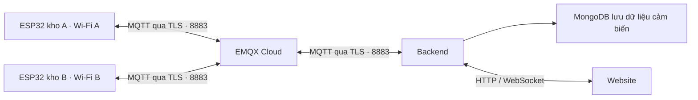

# Hướng dẫn kết nối ESP32 và backend qua EMQX Cloud

> Firmware trong Git đã hỗ trợ TLS (esp-mqtt, `MQTT_URI=mqtts://...`) từ PR #44. Bản firmware
> TLS riêng trước đó (`config.cloud.example.h`, `mqtt_ca.h`, `scripts/generate-mqtt-ca.cjs`,
> `WiFiClientSecure`/PubSubClient) không còn dùng. Mục 4–5 đã được viết lại theo firmware hiện tại;
> kết quả kiểm thử ở các mục sau được ghi lại từ bản cũ.

Cập nhật: 26/10/2026. Áp dụng cho dự án `iot-project-repo`, chế độ `MQTT_MODE=cloud`.

ESP32 và backend cùng kết nối tới EMQX Cloud qua Internet, vì vậy có thể đặt ở các mạng Wi-Fi khác nhau. Docker cần hỗ trợ Compose từ 2.24.4 trở lên để đọc overlay có `!reset`.

## 1. Luồng hoạt động



- ESP32 kết nối Wi-Fi tại kho để truy cập Internet và gửi dữ liệu lên EMQX.
- Backend kết nối cùng broker để nhận dữ liệu, lưu MongoDB và cung cấp dữ liệu cho website.
- Backend gửi cấu hình phòng và lệnh điều khiển qua EMQX về đúng ESP32.
- Website giao tiếp với backend qua HTTP/WebSocket.
- Mỗi ESP32 cần ID riêng; backend dựa vào liên kết thiết bị → phòng → kho trong database để phân loại dữ liệu.

Điều kiện kết nối là cả ESP32 và backend có Internet, phân giải được tên broker và truy cập được cổng 8883. Không cần chuyển tiếp cổng trên router tại kho cho luồng này.

## 2. Thông tin broker đang sử dụng

| Thuộc tính | Giá trị |
| --- | --- |
| Broker | EMQX Cloud |
| Host | `n0c006e0.ala.asia-southeast1.emqxsl.com` |
| Cổng | `8883` |
| Giao thức | MQTT qua TLS |
| URL cho backend | `mqtts://n0c006e0.ala.asia-southeast1.emqxsl.com:8883` |
| Username backend | `iot-backend` |
| Username node thử nghiệm | `esp32-cold-room-01` |
| ID node thử nghiệm | `esp32-cold-room-01` |

Username MQTT, mật khẩu MQTT và thông tin Wi-Fi là các giá trị cấu hình khác nhau. Mật khẩu thực tế không được ghi trong tài liệu này.

## 3. Tạo tài khoản và phân quyền trên EMQX

### 3.1. Authentication: cho phép đăng nhập

Trong đúng deployment của broker trên, mở **Access Control → Client Authentication / Authentication** và tạo:

1. Tài khoản `iot-backend` cho backend.
2. Tài khoản `esp32-cold-room-01` cho node thử nghiệm.

Mỗi thiết bị bổ sung nên có tài khoản riêng. Username không bắt buộc trùng DEVICE_ID, nhưng cấu hình quyền topic phải dùng đúng ID của thiết bị.

### 3.2. Authorization: giới hạn quyền gửi và nhận

Trong **Client Authorization / Authorization**, dùng tab **Username** để thêm các quyền sau:

| Username | Action | Topic | Permission |
| --- | --- | --- | --- |
| `iot-backend` | Subscribe | `devices/+/telemetry` | Allow |
| `iot-backend` | Subscribe | `devices/+/ack` | Allow |
| `iot-backend` | Publish | `devices/+/commands` | Allow |
| `iot-backend` | Publish | `devices/+/config` | Allow |
| `esp32-cold-room-01` | Publish | `devices/esp32-cold-room-01/telemetry` | Allow |
| `esp32-cold-room-01` | Publish | `devices/esp32-cold-room-01/ack` | Allow |
| `esp32-cold-room-01` | Subscribe | `devices/esp32-cold-room-01/commands` | Allow |
| `esp32-cold-room-01` | Subscribe | `devices/esp32-cold-room-01/config` | Allow |

Trong tab **All Users**, thêm quy tắc cuối cùng:

| Topic | Action | Permission |
| --- | --- | --- |
| `#` | Publish and Subscribe | Deny |

EMQX xét quy tắc Username/Client ID trước All Users. Cấu hình trên cho phép từng tài khoản làm đúng các thao tác đã cấp và chặn các thao tác còn lại.

Ý nghĩa các topic:

- `telemetry`: dữ liệu cảm biến và trạng thái từ ESP32.
- `ack`: ESP32 xác nhận đã xử lý lệnh.
- `commands`: backend gửi lệnh điều khiển.
- `config`: backend gửi cấu hình phòng lạnh.

Dấu `+` là ký tự đại diện cho một cấp topic, giúp backend nhận dữ liệu của nhiều ID. Tài khoản thiết bị được cấp các topic cụ thể của chính nó.

## 4. Chuẩn bị chứng chỉ CA

Tải CA của broker từ trang thông tin deployment EMQX. Trong dự án hiện tại:

```text
iot-project-repo/
└── certs/mqtt/emqxsl-ca.crt
```

- Backend đọc CA từ file `certs/mqtt/emqxsl-ca.crt` (`MQTT_CA_FILE`).
- Firmware (esp-mqtt) xác minh chứng chỉ bằng bộ CA có sẵn trong Arduino-ESP32 core, không cần nhúng file CA. Chỉ khi muốn ghim một CA riêng mới bỏ comment `MQTT_CA_CERT` trong `config.h` và dán chuỗi PEM đầy đủ.
- CA công khai có thể lưu cùng mã nguồn. Mật khẩu nằm trong các file cấu hình riêng được Git bỏ qua.

Kết nối TLS phải xác minh chứng chỉ và hostname của broker.

## 5. Cấu hình và nạp ESP32

### 5.1. File cấu hình riêng

Sao chép `firmware/cold_room_monitor/config.example.h` thành `config.h` trong cùng thư mục (file này được gitignore), rồi chọn dòng `MQTT_URI` của chế độ cloud. Các giá trị chính:

```cpp
#define WIFI_SSID         "TEN_WIFI_TAI_KHO"
#define WIFI_PASSWORD     "MAT_KHAU_WIFI"

#define MQTT_URI          "mqtts://n0c006e0.ala.asia-southeast1.emqxsl.com:8883"
#define MQTT_USERNAME     "esp32-cold-room-01"
#define MQTT_PASSWORD     "MAT_KHAU_MQTT_THIET_BI"

#define DEVICE_ID         "esp32-cold-room-01"
```

Các giá trị `TEN_WIFI_TAI_KHO`, `MAT_KHAU_WIFI` và `MAT_KHAU_MQTT_THIET_BI` là chỗ điền cấu hình thực tế. Giữ nguyên các dòng còn lại của `config.example.h` (NTP, chân GPIO...). `config.h` cũ dùng `MQTT_BROKER_HOST`/`MQTT_BROKER_PORT` vẫn biên dịch được nhưng firmware ghép thành `mqtt://` (không TLS), nên với EMQX phải chuyển sang `MQTT_URI`.

### 5.2. Nạp bằng Arduino IDE

1. Mở `firmware/cold_room_monitor/cold_room_monitor.ino`.
2. Chọn board phù hợp với thiết bị; node đã thử là ESP32-D0WD-V3, dùng `ESP32 Dev Module`.
3. Chọn đúng cổng USB. Trong lượt thử trên máy này, node ở `COM5`; các cổng COM3/COM4 là Bluetooth.
4. Biên dịch và Upload.
5. Mở Serial Monitor ở `115200 baud`.

Cần Arduino-ESP32 core 3.x; MQTT dùng esp-mqtt có sẵn trong core, không cài PubSubClient. Danh sách thư viện còn lại xem [firmware/README.md](../firmware/README.md).

### 5.3. Dấu hiệu kết nối thành công

Theo dõi lần lượt:

1. Wi-Fi kết nối và ESP32 nhận được IP.
2. Đồng bộ thời gian NTP thành công để kiểm tra chứng chỉ và đóng dấu thời gian dữ liệu.
3. MQTT kết nối tới broker TLS.
4. ESP32 đăng ký nhận các topic `commands` và `config`.
5. Xuất hiện các dòng `[MQTT TX]` chứa dữ liệu JSON.

Node ESP32 hiện tại dùng Wi-Fi **2,4 GHz**. SSID phân biệt chữ hoa/thường: hotspot đã thử thành công có tên **`Iot`**. Khi chuyển sang Wi-Fi khác, cập nhật tên/mật khẩu Wi-Fi trong `config.h` và nạp lại; giữ broker và tài khoản MQTT nếu chúng không đổi.

## 6. Cấu hình backend dùng EMQX

### 6.1. Cấu hình MQTT trong `.env`

Cấu hình EMQX nằm chung trong `.env` ở thư mục gốc repository (xem mục MQTT của `.env.example`), với tiền tố `MQTT_CLOUD_` để không đè cấu hình broker local:

```dotenv
MQTT_CLOUD_URL=mqtts://n0c006e0.ala.asia-southeast1.emqxsl.com:8883
MQTT_CLOUD_USERNAME=iot-backend
MQTT_CLOUD_PASSWORD=MAT_KHAU_MQTT_BACKEND

# Các biến dưới dùng cho script kiểm thử tài khoản thiết bị.
MQTT_CLOUD_DEVICE_USERNAME=esp32-coldroom-01
MQTT_CLOUD_DEVICE_PASSWORD=MAT_KHAU_MQTT_THIET_BI
MQTT_CLOUD_DEVICE_ID=esp32-coldroom-01
```

Overlay cloud đưa các giá trị này vào app/worker dưới tên `MQTT_URL`/`MQTT_USERNAME`/`MQTT_PASSWORD`, và gắn CA `certs/mqtt/emqxsl-ca.crt` chỉ đọc vào container tại `/app/certs/mqtt/emqxsl-ca.crt`.

### 6.2. Áp dụng vào Docker

Sử dụng file Compose của môi trường đó cùng `docker-compose.cloud-mqtt.yml`. Cả **app và worker** cần nhận cấu hình mới.

Với stack local đã có `.env` chứa đúng thông tin datastore/secrets và các dịch vụ phụ thuộc đang chạy, lệnh mẫu từ gốc repository là:

```powershell
docker compose -f docker-compose.yml -f docker-compose.cloud-mqtt.yml up -d --build --no-deps app worker
```

Lệnh mẫu này yêu cầu `.env` đã được chuẩn bị theo cấu hình đang dùng. Giữ nguyên tài khoản MySQL, MongoDB, Redis, MinIO, các secret ứng dụng và cổng backend; không thay bằng giá trị mẫu khi chuyển broker.

Phiên local đã kiểm thử trên máy này dùng cấu hình bổ sung để giữ các giá trị sẵn có, giữ API ở cổng `18080` và cho phép đăng nhập HTTP từ frontend `5174`. Nếu tái tạo phiên local, cần giữ cả `NODE_ENV=development` và CORS cho `http://127.0.0.1:5174` / `http://localhost:5174`; lệnh mẫu trên tự nó không thể hiện các override riêng đó.

Nếu môi trường đã được khởi tạo bằng `init.sh` và vận hành qua `run.sh`, sử dụng trong Bash:

```bash
MQTT_MODE=cloud ./run.sh rebuild app worker
MQTT_MODE=cloud ./run.sh logs app
```

`run.sh` dùng file Compose production của repository. Các lệnh này là hướng dẫn vận hành cho môi trường tương ứng; production chưa được thay đổi trong lượt kiểm thử local.

**Đổi file `.env` chưa cập nhật môi trường của container đang chạy.** Cần tạo lại app/worker bằng cấu hình cloud; `docker restart` đơn thuần giữ các biến môi trường cũ.

Không chạy lại `init.sh` để chỉ chuyển broker vì script đó có bước seed. Container Mosquitto cũ có thể vẫn còn chạy, nhưng app/worker đã chuyển sang URL EMQX sẽ giao tiếp qua EMQX.

### 6.3. Backend chạy trực tiếp trên máy

Nếu chọn chạy backend ngoài Docker, giữ cấu hình datastore/secrets trong `server/.env` và đặt MQTT trong file đó trỏ tới EMQX (`MQTT_URL`, `MQTT_USERNAME`, `MQTT_PASSWORD` của backend, `MQTT_CA_FILE=../certs/mqtt/emqxsl-ca.crt` — đường dẫn tương đối với `server/`), rồi chạy từ `server/`:

```powershell
pnpm run start:dev
```

Đây là phương án thay thế cho chạy app backend trong Docker. Đảm bảo frontend trỏ tới đúng backend đang sử dụng.

## 7. Đăng ký thiết bị và gán đúng phòng/kho

Tạo tài khoản trên EMQX không tự tạo bản ghi thiết bị trong database của ứng dụng.

Thực hiện bằng tài khoản Admin trên website:

1. Tạo hoặc chọn kho và phòng lạnh cần quản lý.
2. Đăng ký thiết bị với `uniqueId` bằng đúng `DEVICE_ID` trong firmware, ví dụ `esp32-cold-room-01`.
3. Tạo mã claim cho thiết bị.
4. Dùng mã claim để gán thiết bị vào phòng lạnh.
5. Kiểm tra thiết bị có heartbeat, dữ liệu mới và cấu hình phòng đã đồng bộ.

Khi thiết bị được gán phòng, backend gửi ngưỡng cấu hình qua topic `devices/<DEVICE_ID>/config`. ESP32 áp dụng cấu hình rồi báo lại phiên bản; `configSynced=true` cho biết phiên bản đã khớp tại thời điểm nhận dữ liệu.

Mỗi thiết bị bổ sung cần ID riêng, tài khoản MQTT riêng, bốn quyền topic tương ứng và bản ghi được gán đúng phòng/kho. Có thể sử dụng chung một broker EMQX cho các thiết bị này.

## 8. Cách kiểm thử

### 8.1. Kiểm tra TLS và quyền MQTT

Từ gốc repository, khi đã cài dependencies của `server/` và điền file cloud:

```powershell
node scripts/check-cloud-mqtt.cjs
```

Script kiểm tra kết nối TLS, quyền subscribe và truyền probe trên telemetry/ack. Probe không retained, không phải JSON dữ liệu cảm biến; script không gửi lệnh điều khiển quạt/còi hoặc thay ngưỡng phòng.

### 8.2. Kiểm tra với node thật ở mạng khác

1. Cho ESP32 kết nối Wi-Fi/hotspot có Internet, khác mạng của máy chạy backend.
2. Giữ hotspot hoạt động và bật dữ liệu di động nếu dùng điện thoại.
3. Kiểm tra Serial Monitor có `[MQTT TX]`.
4. Kiểm tra log backend có `Connected to MQTT broker mqtts://...:8883` và đăng ký nhận `devices/+/telemetry`.
5. Trên website, chọn đúng kho và phòng của thiết bị.
6. Kiểm tra nhiệt độ/độ ẩm, thời điểm cập nhật mới, dữ liệu biểu đồ và cập nhật trực tiếp.
7. Xác nhận dữ liệu được lưu trong collection MongoDB `telemetry_raw` và có heartbeat thiết bị trong MySQL.

Biểu đồ lịch sử dùng các mẫu đã lưu. Biểu đồ dự báo AI cần điều kiện lịch sử riêng của mô hình; kết nối MQTT thành công không đồng nghĩa dự báo AI sẽ xuất hiện ngay.

### 8.3. Kết quả đã xác nhận ngày 23/10/2026

| Nội dung | Kết quả |
| --- | --- |
| Mạng ESP32 | Hotspot Android `Iot`, 2,4 GHz |
| Mạng máy chạy backend | Wi-Fi `P204`, khác mạng ESP32 |
| MQTT | EMQX Cloud qua TLS, cổng 8883 |
| Dữ liệu ghi nhận | Khoảng 30,2°C, độ ẩm 71% ở thời điểm kiểm tra |
| Lưu trữ | Có mẫu thật trong MongoDB `telemetry_raw` |
| Trạng thái thiết bị | Active, có heartbeat |
| API dữ liệu biểu đồ | Có điểm dữ liệu |
| Cập nhật trực tiếp | Nhận được sự kiện WebSocket `coldroom:reading` qua frontend local |
| Cấu hình hai chiều | ESP32 nhận cấu hình phòng, `configSynced=true` |
| Kho/phòng thử | Kho lạnh Tân Bình → `TEST EMQX - ESP32` |
| Backend local | `http://127.0.0.1:18080` |
| Frontend local | `http://127.0.0.1:5174` |

Mở phòng thử khi các dịch vụ local đang chạy:

[Giám sát TEST EMQX - ESP32](http://127.0.0.1:5174/monitoring?room=01a1692b-fb11-74a5-8e99-496b1b7f872b)

Sau khi đăng nhập, chọn kho Tân Bình trong bộ chọn kho nếu giao diện đang chọn kho khác hoặc “Tất cả kho”.

Phòng thử đặt ngưỡng 2–8°C; nhiệt độ bàn thử khoảng 30°C sẽ báo vượt ngưỡng. Node cũng đã báo cửa mở và lỗi nguồn quạt; các trạng thái này cần được đọc theo phần cứng thực tế, không dùng để kết luận MQTT bị lỗi.

Lượt thử xác nhận một node hoạt động qua hai mạng khác nhau. Chưa kiểm thử đồng thời nhiều node ở nhiều kho, chưa thử lệnh điều khiển quạt/còi trong lượt này và chưa áp dụng cấu hình mới cho production.

## 9. Tra cứu lỗi thường gặp

| Hiện tượng | Cần kiểm tra |
| --- | --- |
| ESP32 không vào Wi-Fi | SSID đúng hoa/thường, mật khẩu, băng tần 2,4 GHz, vùng phủ sóng và hotspot còn bật |
| Có Wi-Fi nhưng không tới broker | Internet/dữ liệu di động, DNS và khả năng truy cập cổng 8883 |
| Lỗi TLS | CA đúng broker, hostname đúng và thời gian NTP đã đồng bộ |
| Broker từ chối đăng nhập | Username/password nằm trong Authentication của đúng deployment |
| Kết nối được nhưng gửi/nhận bị chặn | Authorization đúng username, action và topic chứa đúng DEVICE_ID |
| Node có MQTT TX nhưng web không có dữ liệu | Backend có dùng EMQX, uniqueId khớp, thiết bị đã claim vào phòng và đang xem đúng kho/phòng |
| Đã sửa env mà backend vẫn nối LAN | Container cũ chưa được tạo lại với overlay cloud |
| HTTP local không đăng nhập/cập nhật trực tiếp | Đúng API target, CORS, chế độ cookie HTTP local và proxy `/api` / `/socket.io` |
| Có dữ liệu hiện tại nhưng chưa có dự báo AI | Điều kiện lịch sử đầu vào của AI chưa đủ; kiểm tra riêng luồng dự báo |

Kết nối cloud hiện tại không bổ sung cơ chế lưu đệm và gửi bù dữ liệu khi ESP32 mất Internet hoặc backend ngừng nhận. Các mẫu bị bỏ lỡ không được bảo đảm phục hồi chỉ bằng việc chuyển broker.

## 10. File liên quan và tài liệu tham khảo

Đường dẫn dưới đây tính từ thư mục `docs/` chứa bản hướng dẫn trên GitHub:

- [Hướng dẫn trong repository](../docs/CLOUD_MQTT_SETUP.md)
- [Mẫu cấu hình (mục MQTT)](../.env.example)
- [Docker Compose cloud overlay](../docker-compose.cloud-mqtt.yml)
- [Mẫu cấu hình ESP32](../firmware/cold_room_monitor/config.example.h) (chọn dòng `MQTT_URI` cloud)
- [Script kiểm tra MQTT](../scripts/check-cloud-mqtt.cjs)
- [EMQX: kết nối ESP32, TLS và chứng chỉ](https://docs.emqx.com/en/cloud/latest/connect_to_deployments/esp32.html)
- [EMQX: tạo tài khoản MQTT](https://docs.emqx.com/en/cloud/latest/deployments/default_auth.html)
- [EMQX: phân quyền topic](https://docs.emqx.com/en/cloud/latest/deployments/default_authz.html)

Mật khẩu thực tế được giữ trong `.env` (các biến `MQTT_CLOUD_*`) và `firmware/cold_room_monitor/config.h` ở máy triển khai. Hai file này được Git bỏ qua; không đưa mật khẩu vào tài liệu chia sẻ.
