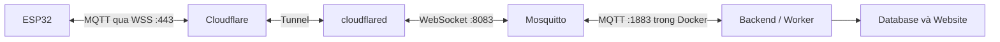

# MQTT qua Mosquitto và Cloudflare Tunnel

Chế độ `MQTT_MODE=tunnel`: tự chạy Mosquitto, thiết bị kết nối qua WSS và Cloudflare
Tunnel. EMQX vẫn dùng được qua `MQTT_MODE=cloud`; chọn một chế độ khi vận hành (so sánh
các chế độ ở [INFRASTRUCTURE.md](INFRASTRUCTURE.md) mục 1). Hostname trên Cloudflare
phải tạo thủ công (mục 3).

## Luồng kết nối



Backend và worker dùng `mqtt://mosquitto:1883`, không dùng chứng chỉ EMQX.
Mosquitto có thêm listener WebSocket 8083. Hai cổng này chỉ nằm trong mạng Docker;
overlay gỡ cổng 1883 đang publish trên host ở file Compose gốc và không publish 8083.
Cloudflare cung cấp WSS cho thiết bị bên ngoài và chuyển tiếp qua Tunnel đến broker.

## 1. Chuẩn bị cấu hình trên máy chủ

Mọi cấu hình MQTT nằm chung trong `.env` gốc (cùng file với MySQL, MongoDB, Redis,
MinIO, JWT và Tunnel), không có file env riêng cho từng chế độ. Không thay các
secret của hệ thống đang chạy bằng giá trị mẫu. Thêm vào `.env` tài khoản của node
chính (xem mục MQTT trong `.env.example`):

```dotenv
MQTT_TUNNEL_DEVICE_ID=esp32-coldroom-01
MQTT_TUNNEL_DEVICE_USERNAME=esp32-coldroom-01
MQTT_TUNNEL_DEVICE_PASSWORD=<mat_khau_node_tren_Mosquitto>
```

`MQTT_TUNNEL_DEVICE_ID` phải trùng `unique_id` của thiết bị trên server và
`DEVICE_ID` trong `config.h`. Backend dùng lại `MQTT_USERNAME`/`MQTT_PASSWORD` đã có
trong `.env` (cùng tài khoản với chế độ local). Overlay tunnel thay tài khoản thiết
bị dùng chung `MQTT_DEVICE_*` bằng tài khoản riêng này; quay lại chế độ local thì
`MQTT_DEVICE_*` lại có hiệu lực, không cần sửa `.env`.

Đây là tài khoản do Mosquitto tự tạo khi khởi động, không phải kiểm tra đăng nhập
với EMQX. Username/device ID chỉ dùng chữ, số, dấu chấm, gạch dưới hoặc gạch ngang.
Mật khẩu phải được thay khỏi placeholder và không chứa xuống dòng. Với ký tự `$`
trong file dotenv, dùng dấu nháy đơn theo quy tắc nội suy của Docker Compose.

App/worker trong overlay luôn dùng MQTT nội bộ và `MQTT_CA_FILE` rỗng. Không nạp
đồng thời overlay cloud và overlay tunnel. Thiết bị kết nối tới
`wss://mqtt.<domain>/mqtt`; hostname này phải được tạo thủ công trên Tunnel (mục 3).

### Thêm nhiều node

Node chính lấy từ `MQTT_TUNNEL_DEVICE_*` trong `.env`. Có thể tạo thêm file riêng
`mosquitto/tunnel-auth/devices.txt` theo `devices.example`, mỗi dòng:

```text
esp32-cold-room-02|esp32-cold-room-02|<mat_khau_02>
esp32-cold-room-03|esp32-cold-room-03|<mat_khau_03>
```

File này chứa mật khẩu, được Git bỏ qua. Dùng UTF-8 không BOM và xuống dòng LF.
Mỗi tài khoản chỉ được publish telemetry/ack và subscribe commands/config của ID
đã gán. Quyền không dựa vào clientId tự khai: đổi clientId thành ID node khác
không mở rộng quyền. Không dùng lại username backend hoặc ID/username node khác.

Thêm mới thiết bị vẫn cần đăng ký `uniqueId` và claim đúng phòng/kho trong ứng dụng.
Provisioning MQTT không tự tạo bản ghi trong database.

## 2. Tạo lại broker và backend khi áp dụng

Cần Docker Compose >= 2.24.4. Các lệnh dưới đây thay cấu hình dịch vụ đang chạy;
thực hiện ở môi trường định chuyển sang Tunnel, sau khi kiểm tra `.env` hiện có.
Không chạy lại `init.sh` để đổi broker vì script đó có bước seed.

Cập nhật mã mới nhất (`git pull`) trên máy chủ trước khi chạy các lệnh bên dưới. Việc checkout mã mới rồi chỉ `docker restart` container
cũ không đổi file config/entrypoint đang mount: cần dùng `up` để tạo lại broker
với overlay tunnel. Các biến `MQTT_TUNNEL_DEVICE_*` trong `.env` chứa thông tin
riêng của máy chủ và không được cung cấp sẵn qua Git.

Với môi trường dùng `docker-compose.production.yml`, trong Bash:

```bash
MQTT_MODE=tunnel ./run.sh up mosquitto
MQTT_MODE=tunnel ./run.sh rebuild app worker
MQTT_MODE=tunnel ./run.sh up cloudflared
MQTT_MODE=tunnel ./run.sh logs mosquitto app
```

`up` chỉ tạo lại các dịch vụ được chỉ định bằng `--no-deps`; các dịch vụ datastore
phải đang chạy. `rebuild` áp dụng cấu hình mới cho app và worker. Đổi giá trị env
cần `up`/tạo lại container, không chỉ `restart`. Sau khi chỉnh riêng danh sách
`devices.txt`, có thể restart Mosquitto để tạo lại tài khoản và ACL.

Lệnh tương đương cho dev stack, trong PowerShell, khi đã chuẩn bị `.env`:

```powershell
docker compose -f docker-compose.yml -f docker-compose.tunnel-mqtt.yml up -d --no-deps mosquitto
docker compose -f docker-compose.yml -f docker-compose.tunnel-mqtt.yml up -d --build --no-deps app worker
docker compose -f docker-compose.yml -f docker-compose.tunnel-mqtt.yml up -d --no-deps cloudflared
```

Overlay cung cấp dịch vụ cloudflared cho dev stack và giữ các dependency app/MinIO
đang có khi ghép với production. Không khởi chạy một connector local dùng token
production một cách tùy tiện: connector cùng Tunnel có thể nhận các route website
hiện có. Cấu hình hostname trên đúng Tunnel của máy chủ định phục vụ MQTT.

## 3. Thêm hostname vào Tunnel khi sẵn sàng

Tunnel phải Healthy và cloudflared phải cùng mạng Docker với Mosquitto.
Nếu hostname đã trỏ đúng `http://mosquitto:8083`, giữ nguyên route đó,
không tạo thêm hostname/DNS trùng.
Trong Cloudflare, mở Tunnel đang dùng, thêm Published application route:

| Trường         | Giá trị dự kiến                                        |
| -------------- | ------------------------------------------------------ |
| Subdomain      | `mqtt`                                                 |
| Domain         | `hwyrd-dev.id.vn`                                      |
| Hostname       | `mqtt.hwyrd-dev.id.vn`                                 |
| Service type   | **HTTP**                                               |
| Service URL    | `mosquitto:8083` (tương đương `http://mosquitto:8083`) |
| Path của route | Để trống                                               |

Service type HTTP là cho bắt tay/nâng cấp WebSocket; payload vẫn là MQTT.
Không chọn kiểu TCP và không trỏ tới cổng MQTT thuần 1883 cho phương án WSS này.
Không thay các hostname API/website đang dùng. Cloudflare tạo DNS cho route
qua dashboard; tài khoản cần quyền quản lý Tunnel và domain tương ứng.

URL thiết bị dự kiến là `wss://mqtt.hwyrd-dev.id.vn/mqtt`, cổng công khai 443.
Cloudflare Access dạng trang đăng nhập tương tác hoặc challenge trình duyệt
không phù hợp với ESP32. MQTT authentication và ACL vẫn được broker kiểm tra;
nếu thêm lớp Access riêng, cần thiết kế xác thực máy với máy tương thích firmware.

### Kiểm tra bắt tay qua hostname

Sau khi broker thực sự mở listener 8083, kiểm tra trên Bash:

```bash
curl --http1.1 --max-time 10 -i https://mqtt.hwyrd-dev.id.vn/mqtt \
  -H "Connection: Upgrade" -H "Upgrade: websocket" \
  -H "Sec-WebSocket-Version: 13" \
  -H "Sec-WebSocket-Key: dGhlIHNhbXBsZSBub25jZQ==" \
  -H "Sec-WebSocket-Protocol: mqtt"
```

Kết quả mong đợi là `HTTP/1.1 101 Switching Protocols`. Với phép thử dùng
`Connection: Upgrade` này, giữ `--http1.1` để curl không thương lượng HTTP/2.
Sau 101, curl có thể chờ đến thời hạn vì WebSocket vẫn mở. 101 xác nhận bắt tay
WebSocket; cần thử MQTT CONNECT bằng tài khoản để xác nhận đăng nhập và ACL.
Nếu vẫn 502 và log cloudflared báo connection refused tới `mosquitto:8083`,
kiểm tra listener và file cấu hình thực tế đang được mount vào broker.

## 4. Firmware

Firmware trong repo (esp-mqtt) đã hỗ trợ WSS, xem [firmware/README.md](../firmware/README.md).
Trong `config.h`:

```cpp
#define MQTT_URI          "wss://mqtt.<domain>:443/mqtt"
#define MQTT_USERNAME     "esp32-coldroom-01"   // MQTT_TUNNEL_DEVICE_USERNAME hoặc một dòng devices.txt
#define MQTT_PASSWORD     "<mat_khau_node>"
#define DEVICE_ID         "esp32-coldroom-01"   // = MQTT_TUNNEL_DEVICE_ID = unique_id trên server
```

Firmware xác minh chứng chỉ Cloudflare bằng bộ CA có sẵn trong core, giữ keepalive
30 giây (Cloudflare cắt WebSocket im lặng khoảng 100 giây) và tự kết nối lại sau 5 giây.
ESP32 kết nối được từ bất kỳ Wi-Fi 2.4 GHz nào có Internet; không cần chạy
`setup-windows-lan.ps1`.

## 5. Kiểm thử trước và sau khi thêm Tunnel

Có thể kiểm thử broker bằng script sau, khi Docker đang chạy và đã cài dependencies
của server (script dùng mqtt module trong `server/node_modules`):

```powershell
node scripts/test-tunnel-mqtt.cjs
```

Script tạo broker riêng với tên ngẫu nhiên, tài khoản thử ngẫu nhiên, cổng localhost
được Docker cấp tự động; không dùng token Cloudflare hoặc mật khẩu thật, không kết
nối backend/node đang chạy. Nó kiểm tra TCP ↔ WebSocket, cấu hình/ack, từ chối sai
mật khẩu, ngăn truy cập topic node khác và giả clientId; sau đó xóa đúng container thử.

Kết quả này kiểm chứng phần broker và cấu hình backend, không chứng minh DNS,
Cloudflare WSS hay firmware thật đã chạy. Sau khi cấu hình Tunnel và nạp firmware,
cần thử node trên Wi-Fi khác server, kiểm tra heartbeat, telemetry MongoDB,
API biểu đồ, WebSocket website và config/ack về đúng node. Tiếp tục thử hai node
ở hai phòng/kho để xác nhận phân loại và quyền truy cập độc lập.

Chuyển broker không tự bổ sung hàng đợi gửi bù khi node mất Internet hoặc backend
ngừng nhận. Giữ các biến `MQTT_CLOUD_*` trong `.env` để quay lại EMQX bằng chế độ
`cloud` nếu cần.

## Tham khảo

- [Cloudflare Tunnel routing](https://developers.cloudflare.com/tunnel/concepts/routing/)
- [Cloudflare WebSocket](https://developers.cloudflare.com/network/websockets/)
- [Mosquitto listeners và ACL](https://mosquitto.org/man/mosquitto-conf-5.html)
- [Cấu hình EMQX hiện có](CLOUD_MQTT_SETUP.md)
